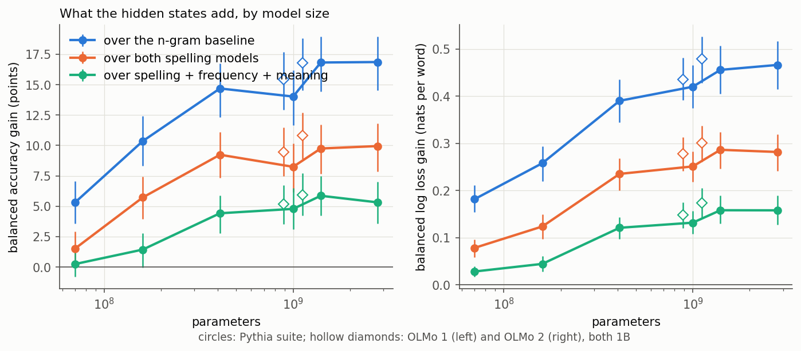
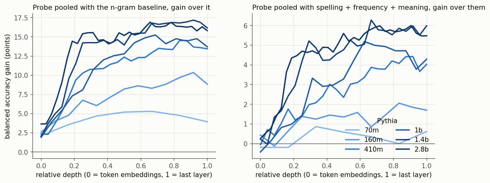
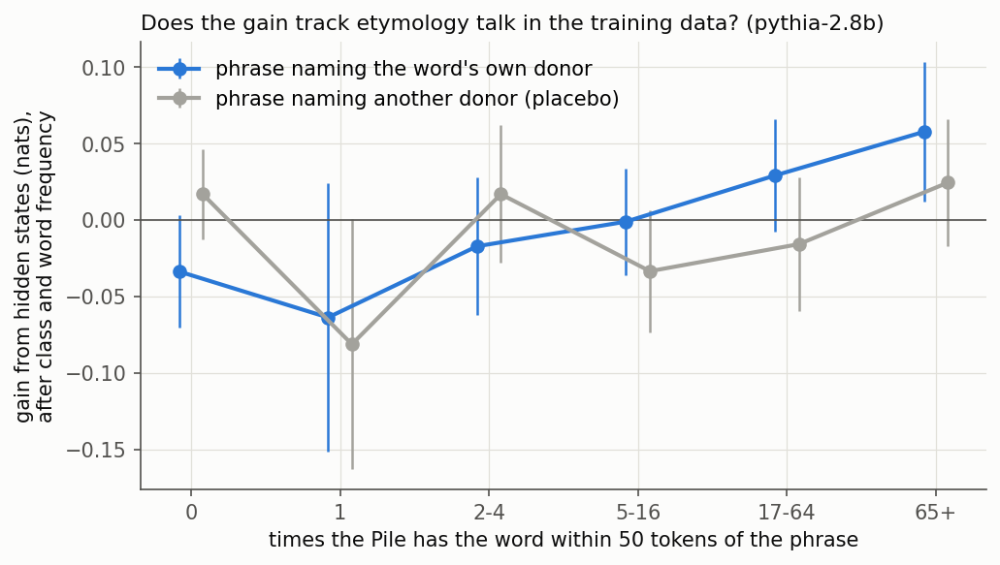
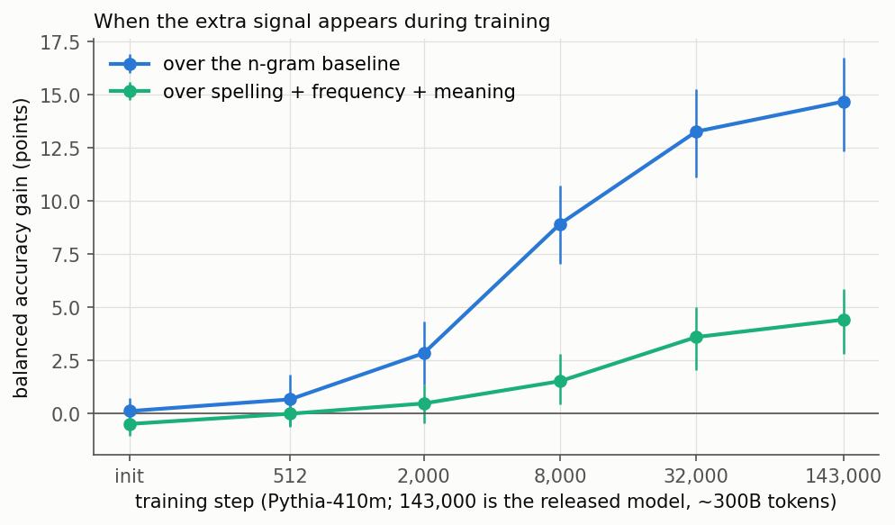
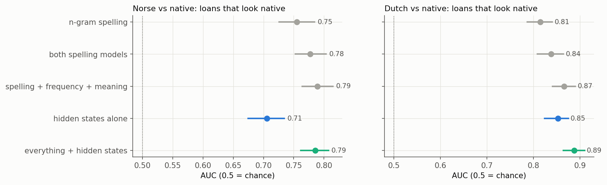
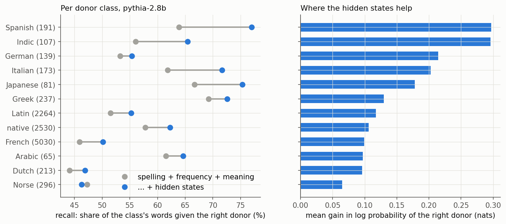

# Do language models know etymology, or just spelling?

Can a linear probe on a language model's hidden states tell where an English word came
from (French, Latin, Old Norse, Dutch, Arabic...) better than its spelling can? And if
it can, does the extra knowledge come from the training text talking about etymology?
This project tests that on 11,326 common English words, eight models (Pythia 70m to
2.8b, OLMo 1 and OLMo 2 at 1B) and five Pythia training checkpoints, all on a laptop CPU.

**Short answer: yes, partly, and the part beyond spelling tracks etymology talk in the
training data. But the showcase case fails.**

- **More than spelling.** Every model from 410m up adds 4 to 6 points of balanced
  accuracy over a baseline that already knows spelling (two models, one trained on
  20,000 extra words), frequency and meaning. Pythia-1.4b: 56.6% to 62.5%.
- **It tracks the corpus.** The words where the hidden states help most are the ones the
  Pile mentions near a phrase naming their own donor ("from Old Norse"). Mentions of a
  wrong donor predict nothing. The link is absent in the smallest model and early in
  training, and appears as training goes on.
- **But not where the hypothesis put it.** Norse loans that look native (*they*, *knife*,
  *window*, *wrong*) stay classed as native. For Norse vs native the hidden states add
  at most 0.014 AUC. Dutch does better. Most of the gain is in Spanish, Italian, Indic,
  Japanese and the French loans that look like English (*view*, *style*, *simple*).



## The question, and why spelling is the trap

Etymology is written into spelling. *Phlegm* is Greek, *fjord* is Norse, *bureau* is
French, and a classifier over letter n-grams gets 43% balanced accuracy over twelve
classes with no knowledge of history at all. A probe that beats it may only have learned
spelling better, from far more words. So the baselines are built to be hard to beat:

| baseline | what it knows | balanced accuracy | log loss (nats) |
|---|---|---|---|
| character 1-5 grams | spelling | 42.9% | 1.775 |
| character CNN | spelling, nonlinear | 42.1% | 1.707 |
| n-grams + 20,767 extra rare words | spelling, with more experience | 50.9% | 1.483 |
| all three pooled | spelling | 52.2% | 1.446 |
| + Zipf frequency, length, token count | + how common | 53.5% | 1.406 |
| + WordNet supersenses and a gloss embedding | + what it means | **56.6%** | **1.285** |

The extra rare words matter most. They are labelled words below the frequency cut,
used only for training, never for testing. With them, spelling alone jumps eight points.
That is the confound a reviewer would raise, measured: much of what looks like
knowledge is exposure to spelling patterns. The meaning control matters too. Japanese
loans name Japanese things and Arabic loans cluster in religion. So a probe could win
on topic alone. The gloss embedding sees each word's dictionary definitions, never the
word itself.

## Method

**Labels.** Every English Wiktionary etymology, walked the way the
[loanword-flow-map](../loanword-flow-map) project walks them. The label is the first hop
out of the English line, the immediate donor: *beef* is French (Anglo-Norman), *sky* is
Norse, *coffee* is Dutch (not Arabic). A word whose chain stays in English back to Old
English is native. Words with a Zipf frequency of 2.5 or more (about 0.3 per million),
lowercase, letters only; classes with fewer than 60 such words are dropped. That leaves
French 5,030, native 2,530, Latin 2,264, Norse 296, Greek 237, Dutch 213, Spanish 191,
Italian 173, German 139, Indic 107, Japanese 81 and Arabic 65.

**Probe.** Each word is read in the same neutral template, "Here is a word: knife". The
hidden state at the word's last token, at every layer, goes through a standardise, PCA
256 and logistic regression pipeline. Classes are weighted equally, so Arabic counts as
much as French.

**Comparison.** All models predict out of fold on the same five splits (stratified,
grouped by stem so *knife* and *knives* never straddle a split). The probe is then
pooled with a baseline log-linearly: one weight per model plus a bias per class. A
pool this small cannot overfit the small classes, so adding a useless model costs
nothing. A gain means the probe carries information the baseline lacks. The layer is
chosen inside each training fold, never on the test words. Intervals are 95% bootstrap
over words, resampled within class.

## Results

### 1. Hidden states beat spelling, frequency and meaning together

| model | probe alone | gain over n-grams | gain over all spelling | gain over everything |
|---|---|---|---|---|
| Pythia-70m | 40.9% | +5.3 [3.6, 7.0] | +1.5 [0.0, 2.9] | +0.2 [-0.8, 1.3] |
| Pythia-160m | 47.2% | +10.4 [8.3, 12.4] | +5.7 [4.0, 7.5] | +1.4 [-0.1, 2.8] |
| Pythia-410m | 53.9% | +14.7 [12.3, 16.8] | +9.2 [7.4, 11.1] | +4.4 [2.8, 5.9] |
| Pythia-1b | 55.7% | +14.0 [11.6, 16.2] | +8.2 [6.1, 10.2] | +4.8 [3.1, 6.5] |
| Pythia-1.4b | 57.9% | +16.8 [14.5, 18.9] | +9.7 [7.7, 11.7] | +5.9 [4.2, 7.5] |
| Pythia-2.8b | 57.4% | +16.9 [14.5, 19.0] | +9.9 [7.9, 11.8] | +5.3 [3.6, 7.0] |
| OLMo-1B-0724 | 56.3% | +15.4 [12.9, 17.7] | +9.5 [7.5, 11.5] | +5.2 [3.5, 6.7] |
| OLMo-2-1B | 58.9% | +16.8 [14.5, 18.8] | +10.8 [8.9, 12.7] | +5.9 [4.3, 7.7] |

Gains are in points of balanced accuracy. The log loss gains tell the same story with
tighter intervals: 0.158 nats per word over everything for Pythia-1.4b [0.130, 0.189].
In the Pythia suite the gain grows to 1.4b and then flattens. OLMo-2-1B, trained on
about 4 trillion tokens against Pythia's 300 billion, matches the best Pythia at less
than half the size. Data seems to matter more than parameters here.

The signal peaks two-thirds to three-quarters of the way through the network (layer 21
of 32 in 2.8b, 12 of 16 in OLMo-2). Averaging the word's tokens instead of taking the
last one is worse (1.4b: +4.1 instead of +5.9). It holds on loans an editor explicitly
marked as borrowings (1.4b: +6.2 [3.4, 9.0]); inferred "derived from" labels are noisier.



### 2. The gain tracks how often the Pile states the etymology

For 3,302 words (every word of the nine small classes and 600 each of French, Latin and
native), the [infini-gram](https://infini-gram.io) index of the Pile, Pythia's training
data, gives three counts. *Own donor*: how often the word sits within 50 tokens of a
phrase naming its own donor ("from Old Norse", "from Middle Dutch"). *Placebo*: the same
for a donor it does not have, picked at random per word. And how often the word occurs
at all. The per-word gain is the log probability the pooled model gives the right donor
minus the baseline's. It is regressed on all three, with class effects:

| model | own-donor co-mentions | placebo co-mentions |
|---|---|---|
| Pythia-70m | +0.005 (p 0.53) | -0.012 (p 0.06) |
| Pythia-160m | +0.033 (p 0.0005) | -0.017 (p 0.03) |
| Pythia-410m | +0.045 (p 0.0007) | -0.011 (p 0.32) |
| Pythia-1b | +0.052 (p 0.0002) | -0.025 (p 0.05) |
| Pythia-1.4b | +0.072 (p 0.000006) | -0.012 (p 0.40) |
| Pythia-2.8b | +0.074 (p 0.000004) | -0.012 (p 0.40) |

Nats of gain per tenfold more co-mentions, robust standard errors. In Pythia-2.8b a word
the Pile puts next to its true donor 100 times gains about 0.15 nats more than one it
never does, against an average gain of 0.16. The placebo is flat or slightly negative,
so this is not words that co-occur with language names in general. The slope grows with
model size, holds on loans alone (+0.095), and is twice as steep on the 1,744 words rare
enough for exact counts (+0.155; the engine subsamples above 500,000 occurrences).



This is correlational. A word the Pile discusses etymologically is also a word whose
history is notable, and the controls (class, frequency, placebo co-mentions) cannot rule
that out. What they do rule out is that the gain simply follows how common a word is,
or how often it appears near language names at all.

### 3. It appears during training, after the spelling

| Pythia-410m checkpoint | init | 512 | 2,000 | 8,000 | 32,000 | 143,000 (final) |
|---|---|---|---|---|---|---|
| gain over n-grams | +0.1 | +0.7 | +2.8 | +8.9 | +13.3 | +14.7 |
| gain over everything | -0.5 | 0.0 | +0.5 | +1.5 | +3.6 | +4.4 |
| mentions slope | +0.000 | +0.002 | +0.009 | +0.026 | +0.043 | +0.045 |



The model first learns what spelling already gives. The part beyond the baselines
arrives later, from step 8,000 on (about 17 billion tokens), and the link with
etymology talk arrives with it.

### 4. The loans that look native mostly stay native

The hypothesis predicted the extra signal would show up where spelling fails: Norse
*they*, Dutch *boss*. It does not for Norse. First, Norse loans are less disguised than
they seem. Spelling alone separates Norse from native at AUC 0.74, mostly through *sk-*
(*sky*, *skirt*, *skull*: native English turned *sk* into *sh*, as in *shirt*). Second,
with dedicated two-class probes on those words only, the hidden states add at most
+0.014 AUC [0.005, 0.025] to the full baseline's 0.790. The probe alone never beats
spelling by more than 0.003. Dutch is better: +0.022 [0.010, 0.035] over a baseline of 0.866 (Pythia-1.4b),
and the probe alone beats spelling by 0.063.



The per-word picture agrees. Of 365 loans the spelling models call native, the full
baseline names the right donor for 11.2% and Pythia-2.8b's hidden states raise that to
22.2%. But 31 of the 43 rescued words are French loans that look English (*view*,
*style*, *simple*, *text*, *award*, *benefit*, *apply*). Only three are Norse: *low*,
*sly*, *blend*. *They*, *knife*, *window*, *wrong* and *ugly* stay native.



By class, the biggest gains are Spanish (recall 64% to 77%), Italian (62% to 72%),
Indic (56% to 65%) and Japanese (67% to 75%). The smallest are Dutch (44% to 47%) and
Norse (47% to 46%). That fits the mention result. Norse loans are among the least
discussed words in the sample (median one co-mention, against 9 for Italian and 22 for
French). Nobody writes "*they*, from Old Norse" often enough to teach it.

### 5. Asked directly, the models know less than the probe finds

Each word was put in 'Etymology: the English word "knife" comes from' and every donor
name scored as the continuation, with each class's average pull subtracted.

| model | asked directly | probe, same words |
|---|---|---|
| Pythia-70m | 25.6% | 42.2% |
| Pythia-410m | 40.5% | 54.2% |
| Pythia-1.4b | 50.1% | 58.1% |
| Pythia-2.8b | 53.3% | 57.8% |

Balanced accuracy on 2,402 words; chance is 8.3%. The gap closes with size: by 2.8b the
model can say most of what the probe can read. For Norse vs native it says almost
nothing (AUC 0.55).

## Caveats

- **Immediate donor.** *Coffee* is Dutch here, *algebra* Medieval Latin. A model that
  "knows" *coffee* is ultimately Arabic is marked wrong.
- **Homographs** take the first etymology Wiktionary lists (*die*, the verb, from Norse;
  not the dice). Short words that are also abbreviations (*mon*, *ret*) add noise to the
  counts.
- **Norse labels are mostly inferred** (278 of 296 from "derived from", not a borrowing
  template), so the explicit-label check cannot test Norse.
- **One template, one corpus index.** Co-mentions are counted only for the Pile; for
  47% of the words they are the engine's subsampled estimates.
- **Pooling, not a joint model.** The probe and baselines are trained separately and
  combined, so the gain is a lower bound on what a joint classifier might extract.

## Traps found on the way

- The flow map's events table keeps one event per (receiving stage, word, donor), so when
  Middle English *þei* has its own page, English *they* is dropped as a duplicate. That
  removes *they*, *knife* and *sugar*. This project re-walks English entries directly.
- A free logistic regression stacked on all models' probabilities (48 × 12 weights)
  overfit the small classes, so adding a model could make it worse. The log-linear pool
  fixed that.
- Frequent words collect chance co-mentions: *they* sits within 50 tokens of "from Old
  Norse" 1,380 times because it is everywhere. The placebo count and the exact-count
  subset handle this.
- The orthographic-borrowing filter that mattered in the flow map removes nothing here:
  no common English word is an orthographic borrowing.
- The infini-gram API answers 403 above roughly 300 requests per five minutes and allows
  four terms per OR clause.

## Running it

Needs the sibling project [loanword-flow-map](../loanword-flow-map) checked out next to
this one, with its `fetch.py` run (this project reuses its etymology table and its walk).
Everything runs on a laptop CPU.

```bash
pip install -r requirements.txt
```

```bash
python build_words.py && python semantics.py && python probe.py baselines
```

```bash
./run_models.sh
```

```bash
python corpus_counts.py
```

```bash
./run_after.sh
```

```bash
python -m pytest
```

`run_models.sh` extracts hidden states and probes every model and checkpoint (about eight
hours at 4 threads; the states take 15 GB). `corpus_counts.py` asks the
[infini-gram](https://infini-gram.io) API how often the Pile puts each word next to an
etymology phrase; the API rate-limits bursts, so it runs at under one query a second
and takes about five hours, resuming from its cache if stopped. `run_after.sh` runs the
two-class tests, the behavioural test, the analysis, the figures and `report.py`, which
prints every number quoted here. The tests need no data or models.

## What the pieces do

| file | role |
|---|---|
| `config.py` | donor classes, models, the template, corpus phrases |
| `build_words.py` | the labelled word list, from the loanword-flow-map walk run on English entries |
| `semantics.py` | the meaning-only control: WordNet supersenses and a gloss embedding |
| `extract.py` | hidden states for every word at every layer |
| `charcnn.py` | the nonlinear spelling baseline |
| `probe.py` | baselines and per-layer probes, all out of fold on the same splits |
| `analysis.py` | pooling, nested layer choice, bootstrap intervals, per-class, pairs, mentions |
| `pairs.py` | dedicated two-class tests: Norse vs native, Dutch vs native |
| `behave.py` | asks the model for the donor directly |
| `corpus_counts.py` | Pile counts and co-mention counts from infini-gram |
| `figures.py`, `report.py` | the figures, and every number in this file |
| `tests/` | the labelling rules, the pooling and the layer choice, as worked examples |
